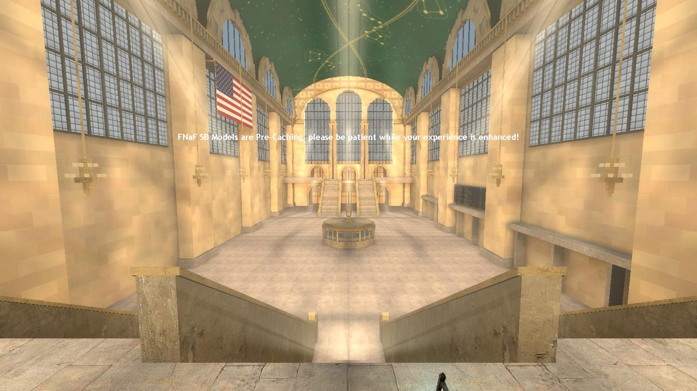
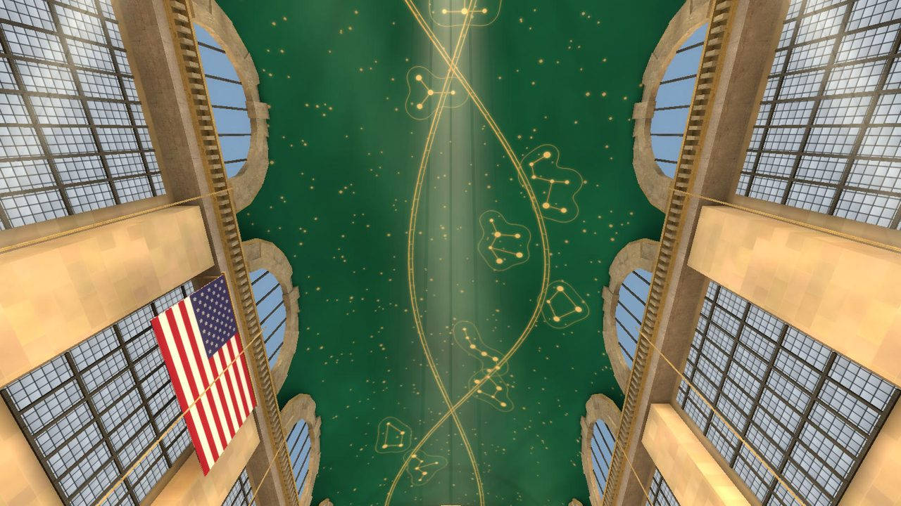

# gm_grand_central

A Garry's Mod map of the Main Concourse of Grand Central Terminal in New York, built at true scale (1 ft = 12 units). It's a work in progress. The concourse comes first; the dining concourse, Vanderbilt Hall, the platforms and the 42nd Street facade come after it (see the [plan](ai-docs/plans/gcs-gmod-plan.md)).

The map is written as VMF text by a Python script, not drawn in Hammer. Every custom texture (the zodiac vault, the marble floor, the ashlar, the clock face, the departure board) is drawn procedurally by a script in `tools/`, with colours sampled from openly licensed photos of the real building.

| | |
|---|---|
|  |  |
|  |  |

## What's in it

- The concourse at about 275 x 120 ft, with a flattened barrel vault that has a 40 ft rise
- A zodiac ceiling mural: green field, gold ecliptic and equator, 12 constellations
- Three arched windows at each end, with mullion grids and fake sun shafts
- The information booth, with its four-faced opal clock
- Double staircases at both ends, balconies, and arcades at floor and balcony level
- Ticket windows, a dot-matrix departure board, 16 chandeliers, and the flag

## Building

You need Windows, Garry's Mod (its `bin/` has vbsp, vvis, vrad and bspzip), Python 3 with Pillow and numpy, and a POSIX shell such as Git Bash.

```sh
export GMOD="C:/Program Files (x86)/Steam/steamapps/common/GarrysMod"   # wherever yours is
python tools/make_vault.py   # and the other make_*.py, only to regenerate textures
sh tools/compile.sh          # build_vmf.py, vbsp, vvis, vrad, bspzip, copy to garrysmod/maps
FAST=1 sh tools/compile.sh   # quicker vvis/vrad for iteration
sh tools/shots.sh            # optional: launch GMod, capture fixed cameras into shots/<stamp>/
```

Then in Garry's Mod: `map gm_grand_central`.

The textures in `src/materials/gcs/` are already generated, so you only need the `make_*.py` scripts when you change them. Some materials point at stock Half-Life 2 textures that ship with Garry's Mod; none of them are redistributed here.

## Credits and licences

- Code (`tools/`): MIT, see [LICENSE](LICENSE).
- Map source, generated textures and screenshots: [CC BY-SA 4.0](https://creativecommons.org/licenses/by-sa/4.0/).
- Reference photos in `refs/photos/` come from Wikimedia Commons under CC0, CC BY 2.0/4.0 and CC BY-SA 4.0. They are used for colour sampling and side-by-side comparison only. Authors, licences and links are in [refs/SOURCES.md](refs/SOURCES.md): Ɱ, Billie Grace Ward, Russ Allison Loar, Charvey90, ArnoldReinhold.
- The README banner is an AI image (Z-Image Turbo, Apache-2.0, seed 11), not an in-game shot.
- This project has no connection to the MTA or Metro-North and uses none of their logos.
