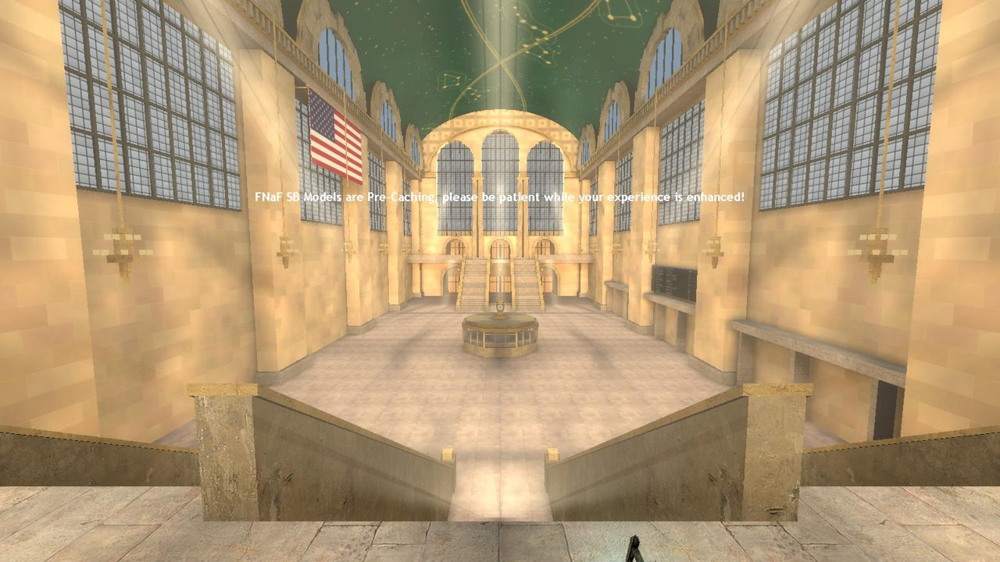

gm_grand_central is a Garry's Mod map of the Main Concourse of Grand Central Terminal in New York, built at true scale (1 ft = 12 units). It's a work in progress, and the concourse comes first.

The map isn't drawn in Hammer. A Python script, `tools/build_vmf.py`, writes the whole VMF as text, and other scripts draw every custom texture. Colours are sampled from openly licensed photos of the real building.

## Pages

- [Building the map](Building-The-Map): what you need, compiling, and loading it in game
- [Tools](Tools): what each script in `tools/` does
- [Reference photos and accuracy](Reference-Photos-And-Accuracy): the photos, their licences, and the measurements that are still estimates
- [Roadmap](Roadmap): the order the areas get built in
- [Changelog](Changelog): what has landed so far

## Status

The Main Concourse is in detail work. It isn't on the Steam Workshop yet; the first upload waits on a look-and-feel sign-off.
